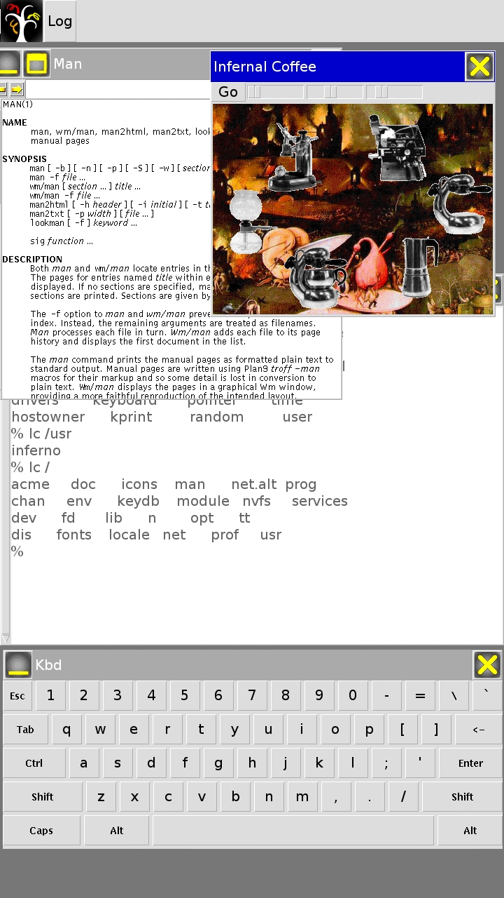
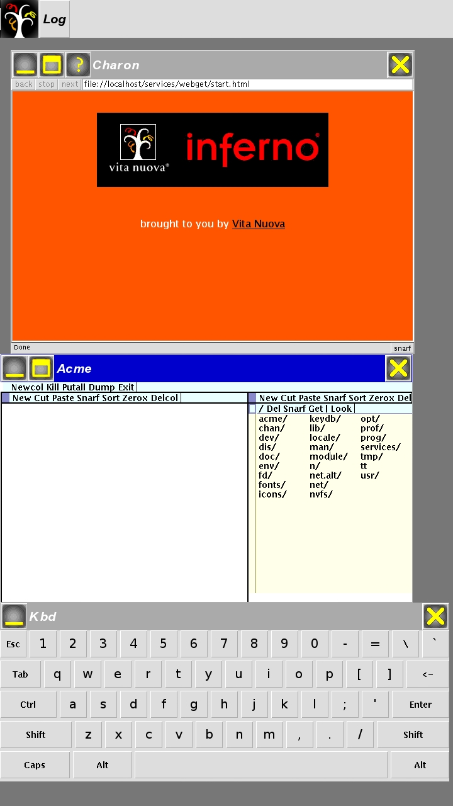

# Inferno-OS_Android

## Build ARM32 and ARM64 from master

On an x86-64 Linux build host, install Android NDK r27c, Python 3, a host C
compiler, CMake and Ninja. Clone the two projects beside each other:

```sh
git clone --branch master https://github.com/bhgv/Inferno-OS-bhgv.git
git clone --branch master https://github.com/bhgv/Inferno-OS_Android.git
workspace="$(pwd)"
(cd Inferno-OS-bhgv && CFLAGS='-O0 -g -fno-strict-aliasing' MKBOOTSTRAP_LIMBO=1 \
    MKBOOTSTRAP_BINDIR="$workspace/host-tools" sh makemk.sh)

for abi in armeabi-v7a arm64-v8a; do
    Inferno-OS_Android/tools/build-android-awm.sh "$abi" "$workspace/Inferno-OS-bhgv" \
        "$ANDROID_NDK_HOME" "$workspace/host-tools" "$workspace/build-$abi" \
        --apk-sdk "$ANDROID_SDK_ROOT" --apk-sign-tools "$APK_SIGN_TOOLS"
done
```

For signed APKs, set `ANDROID_SDK_ROOT` to an SDK with platform 35 and build-tools
35.0.0, and `APK_SIGN_TOOLS` to the directory containing the Go executables
`apksign` and `apksigverify` from [apksig-go](https://github.com/agusibrahim/apksig-go/tree/a0389a9d7f83032504713ac6052f85edfb52f64b).
The build uses OpenSSL and does not invoke Java or Gradle. Omit both signing
options to produce just the shared library. Add `--awm-runner qemu-arm` for
`armeabi-v7a` or `--awm-runner qemu-aarch64` for `arm64-v8a` to exercise AWM
against the native framebuffer fixture.

The ARMv7 build uses classic Dis. The ARM64 build uses the checked native64 AWM
profile. The APKs target Android 5.0 (API 21) or later and use `/sdcard/Inferno`.
Bundled provisioning fills in missing files and preserves existing files.
Grant the test app storage access on the device before launching AWM.

## Changes
* `inferno-os` tree was replaced with the repo `Inferno-OS-bhgv`. use:
```
git clone --recursive https://github.com/bhgv/Inferno-OS_Android
```
(if you need old inferno-os tree [you may get it here](https://github.com/bhgv/Inferno-OS_Android/releases/tag/old_inferno-os_tree) )




for Android > v4.0 (api 14)

it is based on the last [official sources from Vitanuova](https://bitbucket.org/inferno-os/inferno-os/).

## What is working now
* Gui. for compatibility main gui app is `wm/awm` (it loads wm/awm after start). sources are in the `/appl/awm` and `/appl/alib`,
* Touch screen. Only single touches. Don't know where to use multitouches in the Inferno,
* Files. Runtime files remain exclusively in `/sdcard/Inferno`; optional APK provisioning writes missing files directly there.
* Network. Both styx and the regular tcp connections (permission),

## What was changed
* Gui. Bigger icons, bigger keys on the keyboard, bigger captions on windows, some icons were changed (because of sizes),
* Display output. Because of Android. This way is a little experimental still and may be changed in the future.

## What was added
* Was added support of `.PNG` and `.SVG` images. They may used now in the places where may be used .BIT images. For example as a parameter `-bitmap` of Tk controls calls.

* A possibility to resize `.SVG` or `.PNG` images in time of loading them by Tk. (`bitmap :<new size>:<image-path>.svg-or-png`)

* `.TTF` fonts (and maybe `.T1` and other) is supported internally using embedded libfreetype. to use, specify them as subfonts in the font files,

* command line (in the format of the regular emu commang line). has restrictions (mostly in the graphic parameters and the jit). because of restrictions of the hardware. [JIT compiler was buit for other kind of FPU](https://bitbucket.org/inferno-os/inferno-os/issues/344/charon-doesnt-start-on-the-open-pandora#comment-31995777)

* `/dev/audio` and `/dev/audioctl` devices

first it should be mapped to `/dev` fs:
```
bind -b '#A' /dev
```
### possibilities:

* * reading of `/dev/audio` will reads the phone's mic (44.1kHz, 16bit, stereo, raw wave without headers and compression). ex:
```
cat /dev/audio > snd.raw
```
* * writing to `/dev/audio` will outputs the data was written to phones speaker (44.1kHz, 16bit, stereo, raw wave without headers and compression). ex:
```
cat snd.raw > /dev/audio
```
* * `/dev/audioctl` supports now next commands (only writing to):
* * * `load file <file path in the inferno's fs>` - loads the specified file, but don't start to play,
* * * `load uri <uri address of a stream to play>` - loads the specified network stream, but don't start to play,
* * * `unload file` - unloads last loaded file and free used resources,
* * * `unload uri` - unloads last loaded network stream and free used resources,
* * * `play file` - play the loaded file,
* * * `play uri` - play the loaded uri,
* * * `stop file` - stop playing of the file,
* * * `stop uri` - stop playing of the network's stream,
* * * `loop file` or `loop uri` - loops playing of the file or the stream.

all sound streams: record, output of raw wave (`/dev/audio`), playing of a file and network stream use separate buffers and may work simultaneously.

ex:
```
echo load file /mp3/a_music.mp3 > /dev/audioctl
echo play file > /dev/audioctl
```
or
```
echo load uri http://ice1.somafm.com/dubstep-128-mp3 > /dev/audioctl
echo play uri > /dev/audioctl
```
(thanks to somafm.com network radio for provided demo net stream)

* 2nd and 3rd mouse buttons. they are emulated using multitouch possibilities.

### how to use
point or select what you need with 1 finger, after tap somewhere with 1 or 2 more fingers. this will couse a click of 2nd or 3rd mouse button. 

coordinates of the click is the coordinates of the first finger.

* copy/snarf - paste

copy-paste functionality is working now. but only with texts yet.

Inferno's copy paste buffer is separated from the Android copy-paste buffer. actually no way to copy-paste between Inferno and Android.


## Build media note
It is built under Windows. But if you are using Linux it is easy to build it under Linux. only a pair of changes. go to the "inferno-os" folder and rewrite "bld.bat" script to Linux style. also do not forget to configure to Linux tools by modifying "makeconfig" script and so on.

## Dependencies
* Android Studio > v3.0
* Cmake plugin for Android Studio
* NDK 

# Historical Windows/Android Studio build

## Windows host
```
cd inferno-os
bld.bat
```
after the successful building of the inferno libs (`./inferno-os/Android/arm/lib`)
open this project in the Android Studio and build apk.

# how to run
install this apk on the android
Runtime files must already be present in `/sdcard/Inferno`. Optional APK provisioning extracts missing files directly there; no app-private runtime copy is used. See [storage and build options](docs/native-storage.md).

run it



## AWM window-token I/O fix

Use Inferno core experiment f7521acdd7d963c77421f31a03400f14ea6d2e5f or a
revision containing that fix when rebuilding native archives. Ordinary Limbo
byte arrays retain module-owned Type descriptors. The former Sys I/O singleton
check rejected them with Ebadarg, preventing wmlib from reading /chan/wmctl and
leaving the desktop background without its controls. This shared core fix applies
to both renderers; it does not change their different coordinate calculations.

The byte I/O test APKs retain bundled runtime assets and reuse an existing valid
/sdcard/Inferno. No runtime files need to be moved or replaced for this C fix.
The test package suffix changes to avoid ephemeral signing-key collisions; grant
Files/Storage access to the newly installed test application. Source and native
I/O regression checks cannot replace an actual phone launch test.
